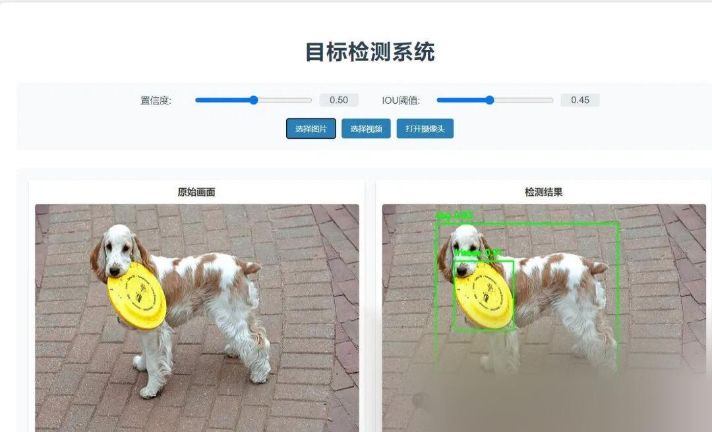

# Build a Beautiful Login Interface and Detection System Based on Yolo11+Flask

This is implemented using Flask to create a visually appealing login interface and a friendly detection interface for YOLOv11 inference and display. The code consists of only two HTML files and one Python file, truly achieving complex functionality with the simplest code possible.

Test passed environment:

windows x64

anaconda3+python3.8

ultralytics==8.3.81

flask==1.1.2

torch==2.3.0

Run steps: Install the environment and execute python main.py

Backend implementation code:

-
-
-
-
-
-
-
-
-
-
-
-
-
-
-
-
-
-
-
-
-
-
-
-
-
-
-
-
-
-
-
-
-
-
-
-
-
-
-
-
-
-
-
-
-
-
-
-
-
-
-
-
-
-
-
-
-
-
-
-
-
-
-
-
-
-
-
-
-
-
-
-
-
-
-
-
-
-
-
-
-
-
-
-
-
-
-
-
-
-
-
-
-
-
-
-
-
-
-

```
from flask import Flask, render_template, request, redirect, url_for, session, flash, Response, jsonifyimport osfrom functools import wrapsfrom ultralytics import YOLOimport cv2import numpy as npimport base64import json
app = Flask(__name__)app.secret_key = 'your_secret_key' # Set the key for session
# Initialize the YOLO11 model
# Login Validation Decoratordef login_required(f):    @wraps(f)    def decorated_function(*args, **kwargs):        if 'logged_in' not in session:            return redirect(url_for('login'))        return f(*args, **kwargs)    return decorated_function
# Login Route
        if username == 'admin' and password == 'admin':            session['logged_in'] = True            return redirect(url_for('detection'))        else:            flash('Invalid username or password!')
    return render_template('login.html')
# Target Detection Route @app.route('/detection')@login_requireddef detection():   return render_template('detection.html')
@app.route('/detect', methods=['POST'])@login_requireddef detect():    try:        data = request.json        image_data = data['image'].split(',')[1]        confidence = float(data['confidence'])        iou = float(data['iou'])
# Decode base64 image
# Running the detection
# Draw the detection results on the image
            cv2.rectangle(image, (x1, y1), (x2, y2), (0, 255, 0), 2)            cv2.putText(image, label, (x1, y1 - 10), cv2.FONT_HERSHEY_SIMPLEX, 0.5, (0, 255, 0), 2)
# Convert the result image to base64
        return jsonify({            'success': True,            'image': f'data:image/jpeg;base64,{image_base64}'        })
    except Exception as e:        return jsonify({            'success': False,            'error': str(e)        })
@app.route('/detect_video_frame', methods=['POST'])
if __name__ == '__main__':    app.run(debug=True)
```

Login interface:


Object Detection Interface:

 


## Payment

Here is a pay link on Stripe ( https://buy.stripe.com/3cs8yP7sY87d0vu9AB ). Please contact me lonlonago@foxmail.com after funding $89, and I will send you a complete data files , thank you!


